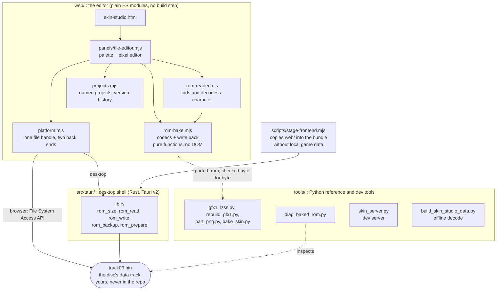
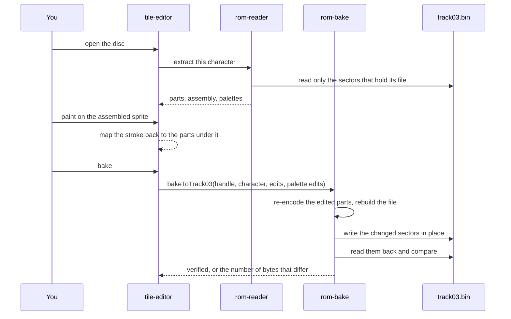

# MvC2 Skin Studio floorplan

A map of this repository for someone opening it cold: what the pieces are, how an edit travels from a
brush stroke into a game disc, and where to start reading.

Written against `master` at `b3380b7` (release `v0.1.0`). Every statement points at a file you can open.
The repository contains no game data; everything is decoded from a disc image the user supplies.

## 1. What this is

An editor for *Marvel vs. Capcom 2* character sprites. You recolour the palette or paint pixels on the
assembled sprite, and it writes the result back into your own Dreamcast disc image so it plays on an
emulator or a real console.

The whole editor is JavaScript that runs in a browser tab. The desktop app is the same pages inside a
window, with a small Rust layer for the one thing a browser cannot do well: read and write a 1.2 GB file
in place.

## 2. The floorplan

## 3. The rooms

| Room | Path | Lines | What it holds |
|---|---|---|---|
| Editor | `web/panels/tile-editor.mjs` | 2,461 | The whole user interface: palette tools, the pixel canvas, animation playback, bulk edits, import and export. It paints on the assembled sprite and decomposes each stroke back to the individual parts. |
| Codecs and bake | `web/rom-bake.mjs` | 250 | Pure functions over byte arrays: the LZSS decoder and encoder (`decodeA`, `encodeA`), the texture twiddle and its inverse, the character file parser (`parseDAT`), the rebuild (`rebuildDat`), and `bakeToTrack03`, which writes the result into the disc. No DOM, so the same file runs in Node for validation. |
| Reader | `web/rom-reader.mjs` | 190 | Finds a character's data file inside the disc's ISO 9660 file system and builds the in-memory structures the editor draws from. It imports its decoders from `rom-bake.mjs`, so there is one copy of each. |
| Platform | `web/platform.mjs` | 114 | Returns a file handle shaped like the browser's File System Access API. In a browser it is the real thing. In the desktop app the same shape is backed by the Rust commands. The reader and the bake never know which one they have. |
| Projects | `web/projects.mjs` | 100 | Named projects with up to 30 saved versions, stored in `localStorage`. A saved state holds only edits (palette changes, painted parts, layer order), never sprite or disc bytes. |
| Desktop shell | `src-tauri/src/lib.rs` | 183 | Five commands. Reads and writes are positioned (seek, then read or write a range), so the large file is never loaded or rewritten whole. `rom_prepare` accepts a zip, a `.gdi` or a raw track and resolves it to the data track. |
| Python tools | `tools/` | about 1,600 | The original implementation of the codecs and the bake, which the JavaScript was ported from. Also a development server and an offline decode for the browser-only workflow. |
| Staging | `scripts/stage-frontend.mjs` | 22 | Copies `web/` into the app bundle and leaves out the folder where locally decoded game data lives, so an installer can never ship any. |
| Release | `.github/workflows/release.yml` | | A version tag builds Windows, macOS and Linux installers and drafts a release. |

## 4. How the game stores a character

Each character is one file on the disc. Its header points at three sections
(described at the top of `web/rom-bake.mjs`):

- **GFX1**, the parts. A table of small images, each 4 bits per pixel, stored in the console's twiddled
  texture order and LZSS-compressed.
- **GFX2**, the assembly. For each sprite, which parts make it up and where each one goes.
- **Palette**, the colours, in several banks for the body, effects and projectiles.

A sprite on screen is many parts placed by the assembly table and coloured by a palette. Parts are shared:
one part can appear in many frames and many animations.

## 5. One edit, brush to disc

What `bakeToTrack03` in `web/rom-bake.mjs` does, in order:

1. Checks the file really is the data track by looking for the ISO 9660 signature, and stops if not.
2. Locates the character's file through the disc's directory and reads only those sectors.
3. Applies palette edits, then rebuilds the parts section if any pixels changed. Edited parts are
   recompressed and the offset table is laid out again.
4. If the rebuilt file is larger than the space its sectors allow, it refuses and says how many bytes over
   it is. It does not write a partial result.
5. Writes the changed sectors at their positions without truncating the file. If the size changed, it
   patches the size in the disc's directory entry in both byte orders the format requires.
6. Reopens the file, reads the sectors back and compares every byte with what it meant to write. The
   result reports `verified` and a difference count.

On the desktop, `rom_backup` in `src-tauri/src/lib.rs` makes a copy of the untouched track beside it before
the first bake, so there is always a way back.

## 6. How it is checked

| Check | Where | What it covers |
|---|---|---|
| Port fidelity | `web/rom-bake.mjs` against `tools/gfx1_lzss.py`, `rebuild_gfx1.py`, `part_png.py`, `bake_skin.py` | The JavaScript codecs and bake are a port of the Python ones and were validated byte for byte against them in Node. That is why the module has no DOM code. |
| Read back | `bakeToTrack03` | Every bake rereads what it wrote and compares it. |
| Strict diagnosis | `tools/diag_baked_rom.py` | Compares a baked track with its untouched backup and validates the edited file the strict way the game's own decoder reads it, to flag anything that would corrupt or crash on a console. |
| No game data in a build | `scripts/stage-frontend.mjs` | The bundle is staged from a copy that excludes locally decoded data. |

There is no automated test suite in the repository. The checks above are run by hand, and each needs a
disc image that cannot be committed.

## 7. Where to start reading

- The format and the codecs: `web/rom-bake.mjs`, top to bottom. It is 250 lines and has no dependencies.
- How a character is found on the disc: `web/rom-reader.mjs`.
- How one code base serves a browser and a desktop app: `web/platform.mjs`, then `src-tauri/src/lib.rs`.
- The editor itself: `web/panels/tile-editor.mjs`. Start from the import block at the top to see what it
  leans on.
- Using it rather than reading it: `README.md`.
